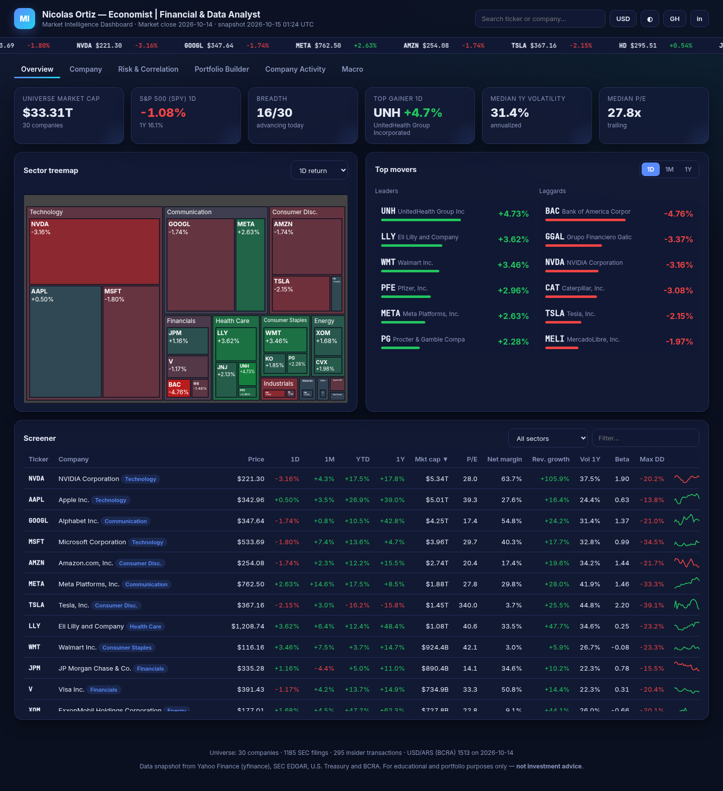
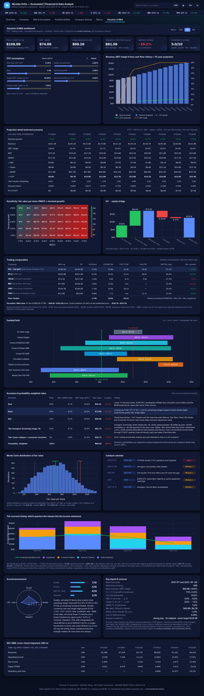
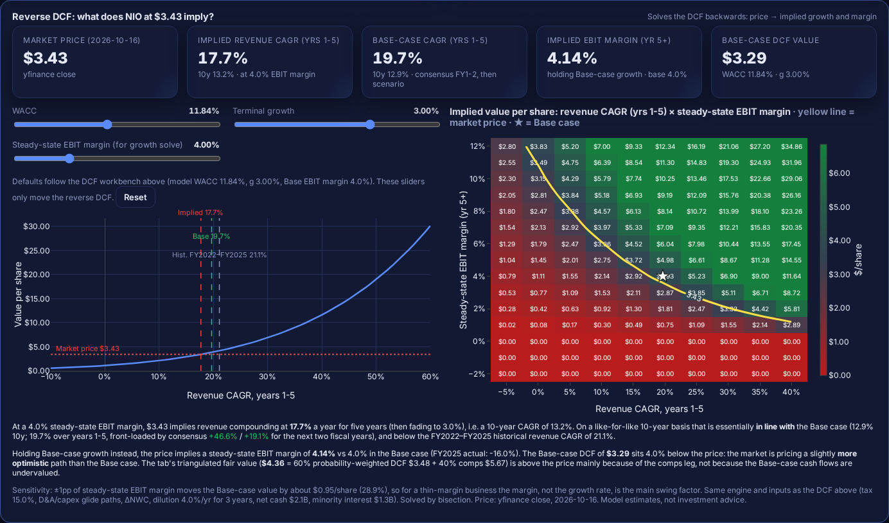

# Market Intelligence Dashboard

**Nicolas Ortiz — Economist | Financial & Data Analyst**

🔗 **Live dashboard:** https://nicolasortizzz.github.io/market-intelligence-dashboard/

An interactive, fully static market-intelligence web app built on **real data** for 31 companies (26 US large caps across 11 sectors, the Argentine ADRs YPF, GGAL, MELI and PAM, and NIO), benchmarked against the S&P 500 (SPY). It brings together prices, risk metrics, fundamentals, a Markowitz portfolio builder, SEC filings, insider trades and US Treasury yields.





## Features

| Tab | What it shows |
|---|---|
| **Overview** | KPI cards, a sector treemap sized by market cap and colored by return (1D/1M/YTD/1Y), top movers, a sortable screener with 30-day sparklines |
| **Company** | Candlestick or line chart with range selector (1M–2Y), range slider, MA50/MA200, volume, multi-ticker comparison (rebased returns), fundamentals, analyst recommendation trend and mean target, dividends, drawdown |
| **Risk & Correlation** | Risk/return scatter (bubble = market cap) with **brush selection** that filters the table, plus a 31×31 correlation heatmap |
| **Portfolio Builder** | Weight sliders, add/remove assets, **Equal / Min-variance / Max-Sharpe** optimizers, an efficient-frontier cloud colored by Sharpe, the capital market line and parametric 1-day VaR (95%) |
| **Company Activity** | SEC EDGAR feed of 8-K/10-Q/10-K/Form 4/20-F/6-K filings (180 days) with filters, parsed Form 4 insider transactions, net insider flow by ticker, a filing timeline and upcoming earnings dates |
| **Valuation & M&A** | DCF workbench for **META, UNH, DIS, NIO, YPF, MU, ASML, VST, ABEV, UBER, BE, AVGO, VIST, TSM, SPCX, 005930.KS (Samsung Electronics)** plus a residual-income (bank) model for **GGAL**: 10-year projections, WACC/terminal-growth/margin/capex sliders, a WACC × g sensitivity heatmap, an EV→equity bridge, trading comps, a precedent-transaction and control-premium view, a football field, Bear/Base/Bull plus tail scenarios with probabilities, a Monte Carlo distribution, a **reverse DCF** (growth and margin implied by the current price, with a growth × margin grid), a catalyst calendar, quarter-by-quarter timing of the Avengers: Doomsday tail for DIS, and a scored assessment |
| **Macro** | US Treasury par yield curve (latest vs ~1M and ~6M ago), 10Y vs 2Y with the spread, and the official USD/ARS rate from BCRA |

Also included: global ticker search (press `/`, use arrow keys), a **USD ⇄ ARS** toggle (BCRA official rate), dark/light theme, skeleton loaders, animated counters and transitions, a responsive layout and deep links (`#company/MELI`).

## Data sources

| Source | Data | Access |
|---|---|---|
| Yahoo Finance via [`yfinance`](https://github.com/ranaroussi/yfinance) | 2y daily OHLCV, adjusted closes, fundamentals, dividends, analyst recommendations, earnings dates | Free, unofficial |
| [SEC EDGAR](https://www.sec.gov/edgar/sec-api-documentation) | `submissions` API (recent filings) and Form 4 XML (insider transactions) | Free, no key; a declared User-Agent is required |
| [U.S. Treasury](https://home.treasury.gov/resource-center/data-chart-center/interest-rates) | Daily par yield curve | Free CSV |
| [BCRA](https://www.bcra.gob.ar/) | Official USD/ARS exchange rate (`estadisticascambiarias` API) | Free, no key |

## Methodology

- **Returns**: from adjusted closes (dividends and splits included). 1D/1M/3M/1Y = 1/21/63/252 trading days.
- **Volatility**: standard deviation of daily returns over the last 252 days × √252.
- **Annualized return** (used for risk/return and Markowitz): mean daily return × 252, i.e. the arithmetic, historical mean. It is **not a forecast**.
- **Beta**: Cov(asset, SPY) / Var(SPY) on 1Y daily returns.
- **Drawdown**: price / running maximum − 1. The maximum drawdown is measured over the last year.
- **Correlation / covariance**: Pearson correlation of 1Y daily returns. Covariance is annualized (×252).
- **Markowitz**: long-only and fully invested. The frontier is approximated with 2,500 random Dirichlet-style portfolios, and Min-variance / Max-Sharpe are found by random search plus local pairwise-swap refinement. The risk-free rate is the latest 3-month T-bill par yield.
- **VaR (95%, 1-day, parametric)**: 1.645·σ/√252 − μ/252.
- **Insider flow**: up to the 6 most recent Form 4 filings per company are parsed. Value = shares × price, with dispositions counted as negative. Grants and awards without a price add zero value.
- **ARS amounts**: USD values × the BCRA official rate on the snapshot date. They are a conversion only.


## Valuation & M&A tab: methodology

🔗 **Live:** https://nicolasortizzz.github.io/market-intelligence-dashboard/#valuation

> ⚠️ Everything in this tab beyond the reported financials is a **model estimate**: projections, margins, scenario probabilities, tail events and precedent ranges are analyst assumptions kept in [`data/valuation_assumptions.json`](data/valuation_assumptions.json). It is a teaching and portfolio tool, **not investment advice**.

**Inputs (real data, `data/valuation.json`, from `scripts/fetch_valuation.py`)**
- Yahoo Finance via yfinance: annual income statement, cash flow and balance sheet (revenue, operating income, D&A, capex, FCF, debt, cash, minority interest), TTM revenue/EBITDA, consensus revenue and EPS estimates (current and next FY), analyst targets, the 52-week range and beta.
- SEC EDGAR XBRL `companyfacts`: reported revenue, operating income, net income, capex and operating cash flow (US-GAAP, annual CY frames), shown as a cross-check table.
- Risk-free rate: latest U.S. Treasury 10Y par yield (`macro.json`).
- NIO reports in CNY. Statements are converted to USD at the Yahoo CNY/USD rate in the snapshot. The ADS ratio is 1:1.

**DCF (FCFF, 10 years)**
- Revenue: years 1-2 use Yahoo consensus growth (± a scenario adjustment), years 3-5 a scenario growth rate, and years 6-10 fade linearly to terminal growth.
- EBIT margin moves linearly from the last fiscal year to the scenario target by year 5. D&A and capex (% of revenue) move from the current or guided level to steady state by year 6. META's year-1 capex reflects its 2026 guidance of $130-145B.
- FCFF = EBIT×(1−t) + D&A − capex − ΔNWC (no tax shield on losses). Discounting is mid-year with a stub-year adjustment: only the unelapsed fraction of the current fiscal year is counted, because the balance sheet already reflects the rest.
- Terminal value uses the value-driver formula: NOPAT₁₁ × (1 − g/RONIC) / (WACC − g), with RONIC = 15%.
- WACC = market-value weights of equity and debt. Ke = rf + β × ERP (4.5%) + country risk (NIO +1.5%). β is Blume-adjusted (0.67β + 0.33), with documented overrides for UNH (0.85) and NIO (1.6). Kd = rf + spread, after tax.
- Equity = EV − net debt − minority interest − scenario one-offs (e.g. fines or settlements). Per share uses market cap / price, adjusted for assumed dilution or buybacks over 3 years. The value is floored at 0 (limited liability).

**Reverse DCF (what the price implies)**



- Runs the same DCF engine backwards (same WACC, tax, D&A/capex glide paths, ΔNWC, dilution, net debt, minority interest and terminal value) against the latest close in `data/reverse_dcf.json` (`scripts/fetch_reverse_dcf.py`, yfinance).
- **Implied revenue CAGR**: a flat growth rate for years 1-5 (fading linearly to terminal g over years 6-10) that makes the DCF value equal the market price, at a chosen steady-state EBIT margin (default: the Base-case target). Solved by bisection; the 10-year CAGR is shown for a like-for-like comparison with the Base case, whose growth is front-loaded by consensus.
- **Implied EBIT margin**: the year-5+ margin that matches the price while holding the Base-case revenue path.
- A growth × margin heatmap of value per share with the market-price contour. Its axes are adaptive: centred on the implied point (implied CAGR, target margin) and sized so most cells fall within ~0.3×-3× the current price (colour on a log scale vs price, ¼×-4×); they are rebuilt whenever the price or a slider changes. NIO's margin axis is extended to 18%. a value-vs-growth curve marking implied, Base-case and historical growth, and sliders for WACC, terminal growth and target margin.
- **Historical 5-year revenue CAGR** (`data/revenue_history.json`, `scripts/fetch_revenue_history.py`): reported revenue FY2020→FY2025, i.e. 5 compounding periods, shown as a KPI next to the implied CAGR, as a dash-dot reference line on the value-vs-growth curve and the heatmap (the FY2022-25 3-year CAGR stays as a fainter line), in the "Key inputs & sources" table, and with its source and span in the card tooltip and footnote.
  | Ticker | Span | Currency | 5y CAGR | Source |
  |---|---|---|---|---|
  | META | FY2020→FY2025 | USD | 18.5% | SEC XBRL `RevenueFromContractWithCustomerExcludingAssessedTax` |
  | UNH | FY2020→FY2025 | USD | 11.7% | SEC XBRL `Revenues` |
  | DIS | FY2020 (ended 2020-10-03)→FY2025 (ended 2025-09-27) | USD | 7.6% | SEC XBRL `Revenues` |
  | NIO | FY2020→FY2025 | RMB (constant currency) | 40.0% (USD convenience translation 38.1%) | SEC XBRL, 20-F |
  | YPF | FY2020→FY2025 | USD (functional currency) | 13.7% | SEC XBRL `ifrs-full:Revenue` (USD), 20-F; Yahoo's ARS-labelled figures not used |
  | GGAL | FY2020→FY2025 | USD at year-end BCRA A3500 (84.15 / 1,455) | 19.9% (real ARS 10.3%) | 20-F FY2020 + 4Q2025 release |
  | MU | FY2020 (ended 2020-09-03)→FY2025 (ended 2025-08-28) | USD | 11.8% (latest FY2021→FY2026: 36.9%) | SEC XBRL `RevenueFromContractWithCustomerExcludingAssessedTax` (10-K) |
  | ASML | FY2020→FY2025 | EUR (constant currency) | 18.5% (USD at ECB year-end rates 17.5%) | SEC XBRL US GAAP 20-F net sales (EUR) |
  | VST | FY2020→FY2025 | USD | 9.2% (partly inorganic: Energy Harbor, Mar-2024) | SEC XBRL `us-gaap:Revenues` (10-K) |
  | ABEV | FY2020→FY2025 | BRL (constant currency) | 8.6% (USD at BCB PTAX year-end rates 7.4%) | SEC XBRL `ifrs-full:Revenue` (20-F) |
  | UBER | FY2020→FY2025 | USD | 36.1% (FY2020 COVID-depressed; also principal-reporting changes and acquisitions) | SEC XBRL `us-gaap:Revenues` (10-K) |
  | BE | FY2020→FY2025 | USD | 20.6% | SEC XBRL `us-gaap:Revenues` (10-K) |
  | AVGO | FY2020→FY2025 | USD | 21.7% (partly inorganic: VMware from FY2024; FY ends ~early Nov) | SEC XBRL `us-gaap:Revenues` (10-K) |
  | VIST | FY2020→FY2025 | USD | 55.3% (FY2020 COVID-depressed; FY2025 partly inorganic: Petronas 50% of LLL, Apr-2025) | SEC XBRL `ifrs-full:Revenue` (20-F); FY2025 from the filed 20-F (not yet in companyfacts) |
  | TSM | FY2020→FY2025 | TWD (constant currency) | 23.3% (USD 20-F convenience translations 20.5%) | SEC XBRL `ifrs-full:Revenue` (20-F); FY2025 from the filed 20-F |
  | 005930.KS | FY2020→FY2025 | KRW (constant currency) | 7.1% (full memory cycle incl. the 2023 bust) | Samsung annual reports (FY2020-21), Yahoo statements (FY2022-25); USD at ECB year-end cross rates |
  | SPCX | FY2023→FY2025 (**2 years only**: IPO 2026-06-12, earlier years not disclosed) | USD | 34.1% (2 compounding periods; Connectivity 71.6%, Space 7.2%, AI 4.0%) | IPO prospectus (424B4), recast for the xAI/X common-control mergers |
- GGAL "revenue" = net operating revenue before loan-loss provisions (net operating income + provisions). Each year is in pesos of its own year end (IAS 29); the real-ARS CAGR restates FY2020 to Dec-2025 pesos with INDEC CPI. After provisions the CAGR is 15.0% in USD / 5.8% real. The Dec-2020 official rate under capital controls flatters the USD figure, and the HSBC Argentina acquisition (Dec-2024) makes growth partly inorganic.
- Example (NIO, close of 2026-10-16, $3.43): ~17.7% revenue CAGR for 5 years (13.2% over 10) at a 4% EBIT margin, or a ~4.1% steady-state margin on Base-case growth, i.e. roughly the Base case. Figures update with the data and the sliders.

**Utilities and consumer staples: VST and ABEV**
- **VST (Vistra)**: consensus FY2026-27 revenue (+26% / +8%), a year-1 EBIT margin of 20% (reported figures include hedge marks) rising to 24% in the Base case on nuclear/gas PPAs with hyperscalers; 18% cash tax (45U nuclear PTC), ~3%/yr buybacks for 3 years. Peers CEG, NRG, TLN plus PEG/ETR as regulated references; precedents 8-13x EBITDA (Energy Harbor, Calpine, LS Power). Tails: data-center demand bust (10%), nuclear outage / regulatory shock (5%, ~$3B), ERCOT price-spike event (5%, ~$2.5B Uri-style loss).
- **ABEV (Ambev)**: reports in BRL (IFRS 20-F); computed in BRL and converted to USD per ADR (1 ADR = 1 share, verified from market cap / price) at the **BCB PTAX** rate (`fx.BRLUSD`, with date). Cost of equity adds Damodaran's Brazil CRP (3.24%, Jan 2026) with an assumed beta of 0.75 (Yahoo 0.22). Mid-term growth is in USD-equivalent terms because FX is held flat. Peers BUD, HEINY, FMX, CABGY, STZ; precedents 11-16x EBITDA. Tails: BRL crisis (8%, +300 bp CRP), tax shock (5%: Imposto Seletivo, JCP, contingencies ~$3B), Argentina relapse (2%; Quilmes under IAS 29).

**Platforms: UBER**
- **UBER (Uber)**: revenue = gross bookings (Mobility, Delivery, Freight) × take rate; consensus FY2026-27, then 10% growth and a 17% steady-state **GAAP** EBIT margin (SBC treated as a cost; company adjusted EBITDA is not used); buybacks retire ~2% of shares a year. Equity stakes (Didi, Aurora, Lime, WeRide/Pony.ai...) are non-operating assets added in the EV bridge (`nonOpAssets`, Yahoo "Investments And Advances", latest FY). The ~$4.9B Q3-2025 tax valuation-allowance release is removed from TTM net income before P/E (`peNIExclude`); LYFT is dropped from the P/E statistics for the same reason (`peExcludePeers`), ABNB/BKNG are reference-only. Tails: robotaxi disintermediation by Tesla/Waymo (7%), driver-classification shock (5%, ~$5B one-off), robotaxi upside via AV partnerships (8%).

**Clean power: BE**
- **BE (Bloom Energy)**: solid-oxide fuel cells; consensus FY2026-27 (+104% / +65%) on AI data-center on-site power (AEP, Oracle, Brookfield), then 25% growth and a 20% steady-state EBIT margin in the Base case. Convertible notes are valued **if-converted** (`converts`): in-the-money notes (0% 2030 at $194.97, 3% Green 2029/2028) add conversion shares and are removed from debt (terms from the Q2-2026 10-Q). Beta set to 2.0 (Yahoo 3.78). Comps exclude peers with negative TTM EBITDA (`compsExcludeNegEbitda`: PLUG, FCEL, BLDP, FLNC), leaving GEV/ETN/VRT; precedents on EV/Sales 5-10x. Tails: data-center capex bust (10%), loss of the 48E ITC (5%), large hyperscaler contract win (7%).

**Semis + software: AVGO**
- **AVGO (Broadcom)**: custom AI accelerators/XPUs and Ethernet networking plus VMware software. Consensus FY2026-27 (+66% / +64%), then 15% growth and a 52% steady-state **GAAP** EBIT margin (after VMware intangible amortisation and SBC; D&A glides from ~14% to 3% of revenue as intangibles roll off). ~$59B of debt from VMware in the EV bridge; split-adjusted shares; buybacks offset SBC. Peers NVDA, AMD, MRVL, QCOM, TXN, ADI, ANET (ORCL/MSFT reference-only). Tails: AI capex bust / ASIC in-sourcing (10%), China/Taiwan TSMC shock (4%, ~$30B), multi-GW ASIC ramps (6%).

**Argentine shale: VIST**
- **VIST (Vista Energy)**: Vaca Muerta shale oil, reports in USD. Revenue = production (boe/d) × Brent-linked price (Brent flat in the Base case); consensus FY2026-27 (full year of the LLL interest bought from Petronas), then 8% growth as the VMOS and Duplicar export pipelines open; 36% steady-state EBIT margin, 35% tax, heavy capex. Country risk = full Argentina EMBI (the same 648 bp model value as YPF/GGAL; `fetch_embi.py --apply` now updates all three). Peers YPF, PAM, PBR, EC (EOG/DVN/FANG reference-only). Tails: macro crisis/devaluation (8%, +800 bp CRP), export restrictions/price controls (5%), Brent crash (4%), VMOS ramp upside (3%).

**Foundry: TSM**
- **TSM (TSMC)**: computed in TWD and converted to USD per ADR at the **Central Bank of the R.O.C. (Taiwan) NT$/US$ closing rate** (`fx.TWDUSD`, with date); 1 ADR = 5 common shares (verified in the FY2025 20-F and against the 25.93B common share count). Cost of equity adds Damodaran's Taiwan CRP (0.78%, Jan 2026, Aa3). Consensus FY2026-27 (+46% / +38%: AI accelerators on N3/N2, CoWoS), then 15% growth and a 52% steady-state EBIT margin (overseas-fab dilution), heavy capex, net cash in the bridge. Peers Samsung, Intel, UMC, GlobalFoundries, SMIC (ASML/AMAT reference-only). Tails: China-Taiwan blockade/conflict (5%, ~$150B, +500 bp CRP), US tariffs/export controls (7%), AI capex bust (7%), AI super-cycle (3%).

**Memory and devices: Samsung Electronics (005930.KS)**
- **005930.KS**: KRX common shares, modelled in KRW (K-IFRS) and converted to USD at the **ECB reference-rate cross** (KRW/EUR ÷ USD/EUR, `fx.KRWUSD` with date; `ecb_cross()` in `fetch_valuation.py`); `LOCAL_LISTING` converts price, market cap, 52-week range and targets to USD and keeps the KRW originals. Per-share values apply to common and preferred (005935.KS, ~22% discount, no vote); the London GDR (SMSN.IL) = 25 common shares. Consensus FY2026-27 (+113% / +38%, memory super-cycle), then a normal down-cycle (-6%/yr in years 3-5) and a 22% steady-state EBIT margin. Cost of equity adds Damodaran's Korea CRP (0.64%, Jan 2026, Aa2). Peers SK hynix, Micron, SanDisk, WDC, TSMC (Apple, Xiaomi reference-only). Comps are **cycle-adjusted** (`compsCycle` option): peer median TTM EV/EBITDA and P/E applied to through-cycle EBITDA and net income (average of FY2022-FY2025 and TTM), EV/Sales not used. Tails: memory price crash (10%), Korea/North Korea shock (5%, ~$75B, +400 bp CRP), HBM win / AI super-cycle (8%).

**Space, Starlink and AI: SPCX**
- **SPCX (SpaceX)**: Nasdaq listing since 2026-06-12 (IPO at $135). Three segments: Space (launch, Dragon, Starship), Connectivity (Starlink consumer, enterprise/government, Starlink Mobile) and Super Intelligence (SI: xAI/Grok, X advertising, cloud services, Cursor from 2026-08-14). Statements are recast for the common-control mergers with xAI and X. Shares, cash, debt and TTM figures come from the Q3 2026 8-K (`FILING_OVERRIDE` in `fetch_valuation.py`, used only while Yahoo's statements are older). Consensus FY2026, then an analyst-assumed +90% for FY2027 (consensus +159%), 30% growth in years 3-5 and a 28% steady-state EBIT margin; capex ~120% of revenue in year 1 falling to 18%. Beta 1.6 (assumed; no 5-year history). Peers RKLB, ASTS, IRDM, SATS, VSAT (LMT, NOC, TMUS reference-only). Tails: AI capex bust (7%), Starship failure / key-person / regulatory (6%), multiplanetary super-cycle (5%). The reverse DCF growth bracket goes up to 200% for SPCX (`RV_EXTRA`).

**Historical WACC (standard for every ticker)**
- `scripts/fetch_wacc_history.py` → `data/wacc_history.json`; shown in the "Historical WACC" card (table + line chart, current model WACC highlighted as a star). Banks (GGAL) show the **cost of equity** instead, labelled.
- Per calendar year-end FY2021-FY2025 plus today: risk-free = US 10Y Treasury (^TNX) on that date; beta = 60 monthly returns vs the S&P 500 ending that date, Blume-adjusted (0.67 × raw + 0.33; min 24 months, NIO has 39/51 months in 2021/22); ERP = Damodaran implied ERP (FCFE) at the start of the following year (4.24%, 5.94%, 4.60%, 4.33%, 4.23%); CRP = Argentina EMBI at year-end for YPF/GGAL (1,688 / 2,213 / 1,906 / 635 / 571 bp, api.argentinadatos.com) Damodaran's rating-based China CRP for NIO (0.70% / 1.22% / 1.03% / 0.94% / 0.91%) and Brazil CRP for ABEV (2.97% / 5.19% / 4.40% / 3.34% / 3.24%) and Taiwan CRP for TSM (0.60% / 1.03% / 0.88% / 0.80% / 0.78%) and Korea CRP for Samsung (0.49% / 0.85% / 0.72% / 0.66% / 0.64%; KRX price converted to USD for beta); cost of debt = interest expense / average total debt (floored at rf, capped at rf + 10%), else rf + the model credit spread (+ EMBI for YPF), after tax at the effective rate; weights = market cap at year-end vs book debt at the fiscal year-end.
- All in USD terms (ASML: USD ADR beta and US rf, EUR debt at the ECB year-end rate; NIO debt at year-end CNY/USD). The model WACC can differ from today's historical-method value because the DCF uses documented beta overrides and a 4.5% ERP.
- Recently listed names (`PROXY` in `fetch_wacc_history.py`, SPCX): rows before the IPO and today (fewer than 24 monthly returns) are **estimated**: beta = segment-revenue-weighted median of peer betas (Space LMT/NOC/RKLB, Connectivity IRDM/VSAT/TMUS/ASTS, AI ORCL/META/NVDA/MSFT), equity weight from private tender marks (~$100B 2021 → ~$800B 2025).
- Caveats: FY2021 debt is carried back from FY2022 where Yahoo's statements stop (flagged with *), and legacy low-coupon debt makes interest / debt fall below rf, so Kd is often floored at rf.

**Argentine names: YPF and GGAL**
- **Country risk**: the cost of equity adds the full J.P. Morgan EMBI spread for Argentina, **648 bp at the close of 2026-10-16**, on top of rf (10Y UST) + β × ERP. Betas are documented overrides (YPF 1.1, GGAL 1.15) because Yahoo's 5Y betas (−0.11 and 0.29) are distorted by local ownership and trading.
- **YPF** (1 ADS = 1 Class D share): its functional currency is the **USD** and Yahoo's annual/quarterly statements are in USD, even though Yahoo labels the company "ARS". Debt, cash and TTM revenue/EBITDA are therefore rebuilt from the USD statements (balance sheet 2026-06-30, TTM = Q3 2025-Q2 2026), and Yahoo's ARS revenue consensus is not used for USD growth: FY2026 = H1 2026 reported revenue ($11.5B) + ~$11.5B in H2 at the guided ~$75 Brent (+26%), FY2027 ≈ −2% as Brent normalizes. Year-1 EBIT margin is set at 20% (H1 2026: 23%). Peers: VIST, PAM, PBR, EC. Scenarios include a macro-crisis/devaluation tail (+400 bp country risk, export duties and price controls) and a low-probability tail in which the US Supreme Court revives the $16.1B Petersen/Eton Park judgment against the Republic (voided by the Second Circuit on 2026-03-27, which also confirmed YPF is not liable; plaintiffs petitioned the Supreme Court in October 2026).
- **GGAL** (1 ADS = 10 Class B shares; 1,606.3M Class A+B shares = 160.6M ADR-equivalents) is a bank, so FCFF/EV metrics do not apply. It uses a **residual-income (excess-return) model**: value per ADR = book value + PV of (ROE − Ke) × opening book over 10 years + a terminal residual income. ROE follows consensus EPS for FY2026-27 and converges to a sustainable ROE by year 5; book growth is flat for years 1-5 then fades to g; implied dividends = net income − Δbook.
- **IAS 29 and FX**: GGAL reports in ARS restated for inflation (homogeneous pesos at each statement date). Equity of ARS 9.20T at 2026-06-30 is converted at the **BCRA Com. A3500 rate of that date (1,482 ARS/USD)** → **$38.64 book per ADR**. Older comparatives are restated to later measuring units, so they are not converted into a USD history. The current A3500 rate (1,518 on 2026-10-16) is stored in `valuation.json`.
- **Bank comps**: P/BV (primary) and P/E for BMA, BBAR, SUPV, ITUB and CIB. Peer P/E is TTM while GGAL's TTM earnings are depressed (ROE ~2%), so P/E is applied to FY2026e consensus EPS and shown for reference only; the triangulated value uses P/BV. Precedents use 0.5-1.3x P/BV (Galicia-HSBC Argentina 2024, Macro-Itaú Argentina 2023; estimates).
- **Reverse analysis for a bank** solves for the **implied sustainable ROE** (holding Base book growth) and the implied book-value CAGR (holding the target ROE), with an ROE × book-growth heatmap centred on the implied point.
- Refresh only these two without touching the other snapshots: `python scripts/fetch_valuation.py YPF GGAL`.

**Semiconductors: MU and ASML**
- **MU (Micron)**: fiscal years end on the Thursday closest to 31 August (FY2026 = 53 weeks ended 2026-09-03). Yahoo's annual statements stop at FY2025, so FY2026 (revenue $133.2B, operating income $99.3B, D&A, capex, operating cash flow) is appended from the 10-K via SEC XBRL (`SEC_APPEND` in `fetch_valuation.py`). Years 1-2 use consensus FY2027-28 revenue (+107% / +16%) with a year-1 EBIT margin of 78%. Because memory is highly cyclical, years 3-5 assume pricing normalizes (Base −12%/yr) and the steady-state EBIT margin is a **mid-cycle 38%** (FY2026: 74.6%; FY2016-25 average ~25%). Beta: an assumed 1.6 (Yahoo 2.23). Comps: SK Hynix, Samsung Electronics, WDC, SNDK (KRW listings converted to USD); NVDA and AMD are shown as reference only and excluded from the medians. Precedents: 4-7x peak EBITDA (memory deals at ~5-8x mid-cycle).
- **ASML**: reports in EUR (US GAAP 20-F). The model runs in EUR and converts to USD per ADR (1 ADR = 1 share) at the **ECB euro reference rate** (`fx.EURUSD_ecb`, with date, in `valuation.json`). Consensus net sales FY2026-27 (+36% / +29%), then +6%/yr and a 42% EBIT margin in the Base case. Comps: AMAT, LRCX, KLAC; Tokyo Electron (8035.T) is reference only because its Yahoo fields are internally inconsistent. Precedents: 15-25x EBITDA (ASML-Cymer, KLA-Orbotech, abandoned AMAT-TEL and Lam-KLA).
- Scenarios: **MU** Bear/Base/Bull plus an AI-capex bust / memory crash (12%), a memory-bound AI super-cycle (5%) and a Taiwan/East Asia shock (3%, ~$40B one-off). **ASML** Bear/Base/Bull plus tighter China export restrictions (8%), High-NA everywhere + AI super-cycle (5%) and a Taiwan shock (5%, ~€5B one-off).
- Reverse DCF: the margin solve widens its bracket to 95% when no margin up to 60% matches the price (needed for both names). Refresh only these two: `python scripts/fetch_valuation.py MU ASML && python scripts/fetch_reverse_dcf.py MU ASML`.

**Relative valuation and M&A**
- Trading comps: peer EV/EBITDA, EV/Sales and P/E are **recomputed in USD** (Yahoo's own ratios mix ADR quote and reporting currencies). The IQR is applied to the target's TTM metrics. Outliers are excluded (EV/EBITDA > 60x, P/E > 80x, negatives), and a method is used only with ≥ 2 valid peers.
- Precedent transactions: sector EV/EBITDA (or EV/Sales for NIO) ranges anchored on named deals (e.g. Disney-21CF, CVS-Aetna, Cigna-Express Scripts, Microsoft-Activision, Geely-Volvo) **are estimates**, plus a 15-40% control premium on the unaffected price.
- **Football field**: 52-week range, analyst targets, comps IQR, precedents, takeout range, DCF scenario range and Monte Carlo P10-P90.
- **Triangulated fair value** = 60% probability-weighted DCF + 40% median comps value. Analyst targets are shown only as a cross-check.

**Scenarios, tails and Monte Carlo**
- Each company has Bear / Base / Bull plus two tail scenarios with subjective probabilities that sum to 100%:
  - **DIS**: Avengers: Doomsday mega-hit (Dec 18, 2026 release). The quarterly model splits incremental revenue and operating income across Studio, Home/Disney+, Consumer Products and Experiences for FQ1-FQ4 FY27. A second tail is linear-TV collapse plus recession.
  - **META**: AI super-cycle; regulatory shock (EU DMA, youth-safety litigation, fines).
  - **UNH**: DOJ / False Claims outcome; Medicare Advantage risk-adjustment overhaul.
  - **NIO**: price war plus cash-crunch dilution; battery-swap standard plus subsidy upside.
  - **MU**: AI-capex bust / memory crash; memory-bound AI super-cycle; Taiwan / East Asia geopolitical shock.
  - **ASML**: China export restrictions; High-NA EUV everywhere + AI super-cycle; Taiwan geopolitical shock.
- Monte Carlo (4,000 runs): draw a scenario by probability, then perturb WACC (σ 0.75pp), terminal g (σ 0.4pp), margin (σ 12% relative) and mid-term growth (σ 1.5pp).
- **Scorecard**: quality, growth and risk scores are qualitative (rationale shown in the app). The valuation score is formula-based: 5 + 10 × implied upside, clipped to 1-10.

**Refresh:** `python scripts/fetch_data.py && python scripts/fetch_valuation.py && python scripts/fetch_reverse_dcf.py`. Edit the assumptions in `data/valuation_assumptions.json`.

**Valuation caveats**
- With a 10Y yield of ~5.2%, discount rates are high. DCF values are very sensitive to WACC and g (see the heatmap), and terminal value is 55-66% of EV.
- Argentina: results are very sensitive to the country-risk premium (each +100 bp lowers Ke/WACC-based values materially), Brent (YPF) and the inflation/FX path (GGAL). Yahoo labels both companies ARS; YPF statements are USD while some Yahoo fields (revenue growth, consensus) are ARS-based, so those are not used for USD projections.
- Yahoo statements are standardized and can differ from company-reported "segment operating income" (e.g. DIS). Peer sets are small, and some peers report in other currencies.
- Scenario probabilities and tails are judgment calls. Event-driven tails (box office, DOJ outcomes, subsidies) are illustrative, not predictions.

## Data snapshot and refresh

**One command:** `make update` (or `./update.sh`, `python scripts/update_all.py`) runs every fetch script in order, validates the output and prints a before/after table of prices and fair values; `make deploy` also pushes `main` and `gh-pages`. See [UPDATING.md](UPDATING.md) for setup, what stays manual and how to add a ticker.

The site is static: it reads the JSON files in `data/` (`market.json`, `prices.json`, `activity.json`, `macro.json`), each of which carries a `generatedAt` UTC timestamp. The current snapshot uses the **market close of 2026-10-14**.

To refresh:

```bash
pip install -r requirements.txt
python scripts/fetch_data.py      # ~2 minutes; rewrites market/prices/activity/macro.json
python scripts/fetch_valuation.py # ~20 seconds; rewrites valuation.json
python scripts/fetch_reverse_dcf.py # a few seconds; latest closes for the reverse DCF
python scripts/fetch_revenue_history.py # FY2020-FY2025 revenue (SEC XBRL; GGAL hand-entered)
python scripts/fetch_wacc_history.py   # FY2021-FY2025 + current WACC (Damodaran ERP/CRP, EMBI, ^TNX, ^GSPC)
python -m http.server 8000        # preview at http://localhost:8000
git add data && git commit -m "Refresh data snapshot" && git push
```

Edit `UNIVERSE` in `scripts/fetch_data.py` to change the set of companies. Please keep the SEC User-Agent descriptive (SEC fair-access policy).

## Stack

Vanilla HTML/CSS/JS with [Plotly.js](https://plotly.com/javascript/) for the charts and Python (pandas, numpy, yfinance, requests) for the data pipeline. It is hosted on GitHub Pages and needs no build step.

## Limitations

- Yahoo Finance data is unofficial and can contain gaps or revisions. Fundamentals are trailing and as reported by Yahoo.
- For ADRs (YPF, GGAL, PAM), some fundamentals are reported in ARS by Yahoo, so ratios are fine but absolute figures may differ.
- Insider data covers a sample of the latest Form 4s, not the complete history.
- Historical means are noisy estimators. Optimized portfolios are illustrative.

## Disclaimer

This project is for **educational and portfolio purposes only**. It is **not investment advice** or a recommendation to buy or sell any security. Data may be delayed, incomplete or inaccurate.
